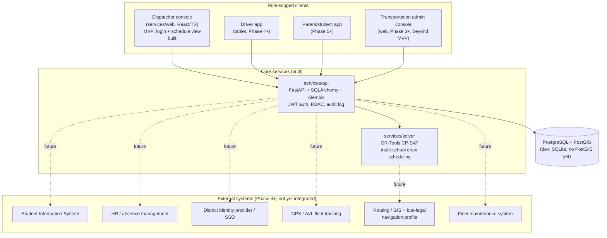

# Architecture map

This is the durable reference for how the pieces fit together and where
each spec requirement lands in the roadmap. Update it whenever a phase
boundary, service boundary, or integration point changes — it should
stay accurate enough that returning to the project after a break, you
can read this instead of re-deriving the plan from the code.

See `docs/domain-model.md` for entity-level detail and `docs/adr/` for
the reasoning behind each irreversible decision. This document is the
map; the ADRs are the reasoning; the domain model is the data.

## System context

`services/solver`, `services/api`, and now `services/web` (Phase 3
MVP: login, view/run a date's schedule, lock/unlock or delete a single
assignment — dispatcher/transportation_admin only) exist and are wired
together end to end. Every other client box is planned, not built —
this diagram is deliberately drawn with the end-state boundaries so
client and integration work slots in without redrawing the map.

## Phase-to-spec mapping

Spec section numbers refer to `Bus Program Specifications Document.docx`.

| Phase | Spec sections covered | Status |
|---|---|---|
| 0 — Domain model + ADRs | §1, §2 (terminology, hard/soft constraint split) | Done |
| 1 — Headless solver MVP | §5 (multi-school crew scheduling), §15 (capacity/qualification), §16 (buffers), §21 (explanations) | Done, hardened (ADR 0005) |
| 2 — Persistence + RBAC | §17 (6 RBAC roles), §21 (audit trail), partial §11 (permanent vs. daily assignment distinction in the data model) | Done (ADR 0006) — see known gaps below |
| 3 — Dispatcher console (web) | §9 (ops visibility), §14 (dispatch), §21 (human override UI) | 🚧 MVP shipped (`services/web`): login, schedule view (run/re-run the solver, view/reassign/lock/delete assignments, all joined to school/driver/vehicle names). Not yet: other roles, any deployment config |
| 4 — Driver app | §9 (driver-facing nav/assignments), §14 (dispatch queue) | Not started |
| 5 — Parent/student app + demand routing | §3 (student/stop assignment), §4 (ridership status), §18 (parent app scope) | Not started |
| 6 — Dynamic rerouting + substitutes + learning | §6/§7 (bus-legal routing, turn/dead-end rules), §8 (district geo knowledge), §10 (dynamic rerouting), §12 (field trips), §13 (absences/substitutes), §20 (historical learning) | Not started |
| Ongoing, no dedicated phase yet | §19 (SIS/HR/SSO/GPS/fleet-maintenance integration) | ADR 0007 written (data ownership + integration shape decided); no integration actually built yet — first one lands whenever the phase that needs it starts |

## Known gaps to close before the next phase

Self-identified gaps, kept here (rather than deleted once closed) so
the history of what was found and fixed stays visible.

1. ~~**No mutation endpoints.**~~ **Closed.** `PATCH`/`DELETE
   /schedule/assignments/{id}` let a dispatcher/admin reassign a
   crew, adjust a time, lock/unlock, or remove a single assignment
   without a full re-solve — every hard constraint the solver enforces
   (qualification, capacity, no overlap, window bounds) is re-checked
   server-side first (`_hard_constraint_violation` in
   `routers/schedule.py`), and every change is audited. `POST
   /schedule` now excludes locked assignments' runs and crews from
   re-solving, so a lock survives a re-schedule. Remaining sub-gap:
   locking a crew's assignment removes that crew from the *entire*
   day's solve, since the solver's `Crew` model has one whole-day
   availability window with no partial-busy-interval support —
   partial-day availability (free a locked crew for the rest of its
   day) is a real future enhancement, not yet built. Still not covered
   by this: stop locations, student reassignment (no Student entity
   yet — spec §3, Phase 5), and route-sequence edits beyond
   crew/time/lock on a single assignment.
2. ~~**No integrations boundary.**~~ **Decision made, not yet built.**
   ADR 0007 establishes the authoritative data source and integration
   shape (federated identity / synced read-model / synced operational
   status / streamed telemetry / external compute) for each of spec
   §19's systems, and the adapter-interface pattern to use when the
   first one is actually integrated (most likely SIS, at the start of
   Phase 5). No code changes yet — this was a design decision, not an
   implementation.
3. ~~**`Driver.max_continuous_minutes` is modeled but unenforced.**~~
   **Closed.** `scheduler.py` now enforces it as a hard CP-SAT
   constraint: a crew's driver never has a duty span exceeding the
   limit, and a single job that alone exceeds it is filtered out of
   candidacy before the model even runs. Phase 1 approximation
   (documented in `docs/domain-model.md`): the whole span from a
   crew's first job to its last counts as one continuous duty period —
   a gap between jobs isn't yet recognized as a qualifying break.

## Service boundaries (ADR 0003)

- **`services/solver`** — pure scheduling/optimization engine. No
  persistence, no HTTP, no auth. Takes in-memory domain objects
  (`Job`, `Crew`, `Vehicle`, `Driver`), returns a `SchedulingResult`
  with structured `Explanation`s. Depends on nothing outside itself
  except OR-Tools and an injected deadhead estimator.
- **`services/api`** — the only service that talks to the database or
  external HTTP clients. Owns auth, RBAC, audit, and persistence; calls
  into `services/solver` as a library (in-process, not a network call)
  from `POST /schedule`.
- Future client apps (dispatcher console, driver app, parent/student
  app) talk only to `services/api` over HTTP — never directly to the
  solver or the database.

This keeps the solver trivially unit-testable (no DB, no auth, no
network) and keeps exactly one service responsible for data ownership
and access control, which is what makes the RBAC and audit guarantees
in ADR 0004/0006 actually enforceable.
