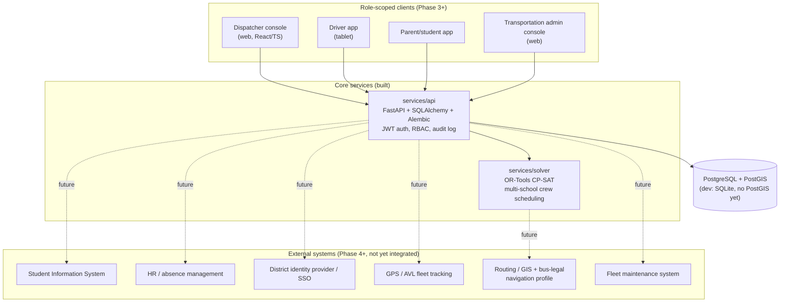

# Architecture map

This is the durable reference for how the pieces fit together and where
each spec requirement lands in the roadmap. Update it whenever a phase
boundary, service boundary, or integration point changes — it should
stay accurate enough that returning to the project after a break, you
can read this instead of re-deriving the plan from the code.

See `docs/domain-model.md` for entity-level detail and `docs/adr/` for
the reasoning behind each irreversible decision. This document is the
map; the ADRs are the reasoning; the domain model is the data.

## System context

Today, only `services/solver` and `services/api` exist and are wired
together (the API's `POST /schedule` endpoint calls the solver against
persisted crews/runs and stores the result with an audit entry). Every
other box is planned, not built — this diagram is deliberately drawn
with the end-state boundaries so client and integration work slots in
without redrawing the map.

## Phase-to-spec mapping

Spec section numbers refer to `Bus Program Specifications Document.docx`.

| Phase | Spec sections covered | Status |
|---|---|---|
| 0 — Domain model + ADRs | §1, §2 (terminology, hard/soft constraint split) | Done |
| 1 — Headless solver MVP | §5 (multi-school crew scheduling), §15 (capacity/qualification), §16 (buffers), §21 (explanations) | Done, hardened (ADR 0005) |
| 2 — Persistence + RBAC | §17 (6 RBAC roles), §21 (audit trail), partial §11 (permanent vs. daily assignment distinction in the data model) | Done (ADR 0006) — see known gaps below |
| 3 — Dispatcher console (web) | §9 (ops visibility), §14 (dispatch), §21 (human override UI) | Not started — **blocked on mutation endpoints, see below** |
| 4 — Driver app | §9 (driver-facing nav/assignments), §14 (dispatch queue) | Not started |
| 5 — Parent/student app + demand routing | §3 (student/stop assignment), §4 (ridership status), §18 (parent app scope) | Not started |
| 6 — Dynamic rerouting + substitutes + learning | §6/§7 (bus-legal routing, turn/dead-end rules), §8 (district geo knowledge), §10 (dynamic rerouting), §12 (field trips), §13 (absences/substitutes), §20 (historical learning) | Not started |
| Ongoing, no dedicated phase yet | §19 (SIS/HR/SSO/GPS/fleet-maintenance integration) | Not started — **needs its own ADR before Phase 4+**, see below |

## Known gaps to close before the next phase

These are real, self-identified gaps — not urgent enough to block this
session's git/lint/DB-refactor work, but they should be the first thing
picked up when Phase 3 starts.

1. ~~**No mutation endpoints.**~~ **Closed.** `PATCH`/`DELETE
   /schedule/assignments/{id}` let a dispatcher/admin reassign a
   crew, adjust a time, lock/unlock, or remove a single assignment
   without a full re-solve — every hard constraint the solver enforces
   (qualification, capacity, no overlap, window bounds) is re-checked
   server-side first (`_hard_constraint_violation` in
   `routers/schedule.py`), and every change is audited. `POST
   /schedule` now excludes locked assignments' runs and crews from
   re-solving, so a lock survives a re-schedule. Remaining sub-gap:
   locking a crew's assignment removes that crew from the *entire*
   day's solve, since the solver's `Crew` model has one whole-day
   availability window with no partial-busy-interval support —
   partial-day availability (free a locked crew for the rest of its
   day) is a real future enhancement, not yet built. Still not covered
   by this: stop locations, student reassignment (no Student entity
   yet — spec §3, Phase 5), and route-sequence edits beyond
   crew/time/lock on a single assignment.
2. **No integrations boundary.** Spec §19 lists five external systems
   (SIS, HR/absence, SSO, GPS/AVL, fleet maintenance) that should be
   sources of truth rather than duplicated. Nothing in the codebase yet
   defines an adapter/port boundary for these. Needs an ADR (data
   ownership per entity, sync vs. webhook vs. polling per source)
   before any Phase 4+ work touches student, absence, or SSO data —
   otherwise integration code will get bolted on ad hoc.
3. **`Driver.max_continuous_minutes` is modeled but unenforced.** The
   field exists in both the solver domain model and the `drivers`
   table, but `scheduler.py` never reads it. Needs a CP-SAT constraint
   (or an explicit ADR deferring it) before driver-hour rules are
   relied on for anything real.

## Service boundaries (ADR 0003)

- **`services/solver`** — pure scheduling/optimization engine. No
  persistence, no HTTP, no auth. Takes in-memory domain objects
  (`Job`, `Crew`, `Vehicle`, `Driver`), returns a `SchedulingResult`
  with structured `Explanation`s. Depends on nothing outside itself
  except OR-Tools and an injected deadhead estimator.
- **`services/api`** — the only service that talks to the database or
  external HTTP clients. Owns auth, RBAC, audit, and persistence; calls
  into `services/solver` as a library (in-process, not a network call)
  from `POST /schedule`.
- Future client apps (dispatcher console, driver app, parent/student
  app) talk only to `services/api` over HTTP — never directly to the
  solver or the database.

This keeps the solver trivially unit-testable (no DB, no auth, no
network) and keeps exactly one service responsible for data ownership
and access control, which is what makes the RBAC and audit guarantees
in ADR 0004/0006 actually enforceable.
