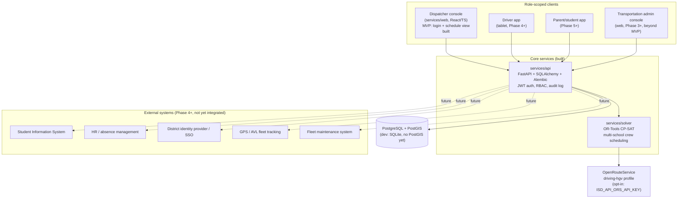

# Architecture map

This is the durable reference for how the pieces fit together and where
each spec requirement lands in the roadmap. Update it whenever a phase
boundary, service boundary, or integration point changes — it should
stay accurate enough that returning to the project after a break, you
can read this instead of re-deriving the plan from the code.

See `docs/domain-model.md` for entity-level detail and `docs/adr/` for
the reasoning behind each irreversible decision. This document is the
map; the ADRs are the reasoning; the domain model is the data.

## System context

`services/solver`, `services/api`, and now `services/web` (Phase 3
MVP: login, view/run a date's schedule, lock/unlock or delete a single
assignment — dispatcher/transportation_admin only) exist and are wired
together end to end. Every other client box is planned, not built —
this diagram is deliberately drawn with the end-state boundaries so
client and integration work slots in without redrawing the map.

The `GPS["GPS / AVL fleet tracking"]` box above is specifically a
*third-party* GPS/AVL vendor system (spec §19) and remains unbuilt —
don't confuse it with the first-party `VehiclePosition` pipeline
(ADR 0009, Phase 6 row below) that now exists: the driver's own
tablet reports position directly to `services/api`, no vendor
integration involved. If a real GPS/AVL vendor is ever added (e.g.
for hardware installed on buses without a driver tablet), it would
feed the same `VehiclePosition` table, not replace this diagram box.

## Phase-to-spec mapping

Spec section numbers refer to `Bus Program Specifications Document.docx`.

| Phase | Spec sections covered | Status |
|---|---|---|
| 0 — Domain model + ADRs | §1, §2 (terminology, hard/soft constraint split) | Done |
| 1 — Headless solver MVP | §5 (multi-school crew scheduling), §15 (capacity/qualification; driver license classes only enforced since PR #49, see `docs/domain-model.md` "Driver license classes"), §16 (buffers), §21 (explanations) | Done, hardened (ADR 0005); §2.2 soft objectives are admin-weighted (crews used, deadhead, arrival buffer — see `docs/domain-model.md` "Optimization weights") |
| 2 — Persistence + RBAC | §17 (6 RBAC roles), §21 (audit trail), §11 (permanent vs. daily assignment: `RouteTemplate`/`CrewTemplate` + idempotent `generate-from-templates`, PR #35 — see `docs/domain-model.md` "Recurring templates") | Done (ADR 0006) — see known gaps below. **Two real gaps closed by a full spec-vs-code audit (2026-09-17)**: `school_admin` had no route to `GET /announcements/mine` despite §17 naming "transportation notices" in that role's access (fixed — `_recipient_school_ids` now covers it), and had no frontend page at all (`services/web`'s new `/school` page: "buses serving the school"/"expected arrivals" via a new `GET /schedule/{date}/school-assignments`, resolved driver/vehicle names, plus the same transportation-notices panel). Separately, §17/§21's "Reports"/"Historical records" access had nothing to serve it — every mutation already wrote to `AuditLogEntry`, but nothing ever read it back; `GET /audit-log` (transportation_admin only) is the first endpoint that does, filterable by entity type/id/date range, paginated, with actor names resolved server-side. `/setup` gained an admin-only "Audit log" section. |
| 3 — Dispatcher console (web) | §9 (ops visibility), §14 (dispatch), §21 (human override UI) | ✅ MVP done (`services/web`): login, schedule view (run/re-run the solver, view/reassign/lock/delete assignments, inline crew+run creation), `/setup` page (schools/qualifications/drivers/vehicles). Console is usable end-to-end without any raw API call. **PR #52**: a live fleet map (Leaflet + OpenStreetMap tiles, `components/MapView.tsx`) above the fleet-position list, with schools for context, and a stops map on Setup where clicking places or relocates a stop. **PR #53**: a "Needs attention" alerts panel (`GET /alerts`, derived live: runs with no bus or needing cover, late starts, unacknowledged work, overruns, silent GPS, unstaffed or overdue field trips, incident and defect reports; see `docs/domain-model.md` "Operational alerts"). **PR #55**: a Reports page (`/reports`: assignments with on-time performance, field trips, absences and cover, driver reports, dispatch tasks, GPS history; each downloadable as CSV) and GPS position history (ADR 0009 addendum), shown as a bus's track on the fleet map. Dockerized (`docker-compose.yml`, both services build+run+pass CI's smoke test). Not yet: other roles (out of Phase 3's own scope — driver app is Phase 4, parent/student is Phase 5) |
| 4 — Driver app | §9 (driver-facing nav/assignments), §14 (dispatch queue) | ✅ MVP done (`services/web`, ADR 0008: responsive web app, not native): `/driver` page for the `driver` role — today's own runs with resolved school/vehicle names (`GET /schedule/{date}/my-assignments`), mark started/completed/no-show (`PATCH /schedule/assignments/{id}/status`, audited), self-report an absence (`POST /drivers/{id}/absences`), auto-report vehicle position while a run is in progress (`PUT /drivers/{id}/position`, ADR 0009), report an incident or vehicle defect (`POST /drivers/{id}/reports`, vehicle auto-resolved from the driver's crew), and see "Messages from dispatch" (`GET /announcements/mine` — see Phase 6 row for both). **PR #51**: the page is now the driver's whole day ("My day"): runs, assigned field trips and dispatch tasks in one time-ordered queue labelled Current / Next / Later (spec §14's example), with each job moved through the §14 lifecycle from the tablet. Dispatchers send unplanned tasks (§14's list) from the Schedule page; a task is busy time for its driver and bus everywhere (see `docs/domain-model.md` "Dispatch tasks"). **PR #56**: in-motion lockout (§9): while the bus is moving (tablet GPS, with hysteresis), typing forms and No-show lock, and the large next-step buttons and read-aloud stay available (see `docs/domain-model.md` "In-motion lockout"). Not yet: turn-by-turn navigation (deferred with §7/§10, same routing-graph dependency), offline support |
| 5 — Parent/student app + demand routing | §3 (student/stop assignment), §4 (ridership status), §18 (parent app scope) | ✅ MVP done (`services/web`): `Student`/`Stop`/`RidershipOverride` entities (manual entry, ADR 0007 precedent — no SIS sync yet); `/family` page for `student`/`parent` roles — each linked child's school/stop and today's AM/PM ridership (`GET /students/my-family`), declare/override ridership per leg (`PATCH /students/{id}/ridership`, also spec §4.5's "late request to ride"; since PR #47 with a district cutoff and time zone, no past-day changes by families, and a full-bus check. §4.5's eligibility and stop-feasibility checks wait on Phase 3); `/setup` gained Students/Stops sections (admin-only creation; guardian linking, student editing and school editing only arrived with PR #48, since the original "manual guardian linking" claim here was never true in the UI). **§4.3, scoped**: `Run` gained a `direction` field and `GET /runs/{id}/expected-riders` computes a real rider count from `Student`/`RidershipOverride` as decision support for `Run.passenger_count` (`PATCH /runs/{id}`, applied manually, flags `ambiguous` when multiple runs share a school/date/direction) — this is *not* §4.3's literal stop-sequence route shortening, which needs a `Route`/stop-sequence model this system has never built. **§18's "approximate bus location" is now done** — `/family` gained a "Locate bus" action per child/leg (`GET /students/{id}/bus-position`, see Phase 6 row), and since PR #52 shows it on a map that stays approximate: the API rounds to about 100 m and the map stops at zoom 15. **PR #57 (Phase 3.1)**: student grade, specialized-transportation and hazardous-route flags, accommodations, admin-only home locations geocoded with the US Census (or placed on the map), district eligibility distance and walk/ride limits by grade band, and each student's eligibility with its reason (see `docs/domain-model.md` "Student eligibility and home locations"). **PR #58 (Phase 3.2)**: recurring routes have ordered stops with planned times; a student's stop decides which of several runs on a leg they ride, so rosters, family bus views and capacity checks no longer go ambiguous when two buses serve one school; drivers see their stops in order. **PR #59 (Phase 3.3)**: stop proposals from students' homes within grade-band walk limits and a minimum spacing, reusing existing stops, curb stops for specialized transportation, and hazard warnings, for staff to approve, reject or relocate (road-aware placement still needs road data). **PR #60 (Phase 3.4)**: OR-Tools route planning (`isd_solver.routing`): the fastest stop order for a route, with each stop's students held to their ride limit and loading time per rider and accommodation, planned minutes and duration, applied on request. **PR #61 (Phase 3.5)**: the day's trip (§4.3): stops nobody rides from that day are skipped, arrival times recalculated (mornings anchored to the school arrival so pickups never move earlier), shown to the driver and, per child, to families with a flag when their time moved 5+ minutes. **PR #62 (Phase 3.6)**: school administrators see each bus's expected time at the school (arriving in the morning, leaving in the afternoon) from the plan, a late start or live GPS through the stops still ahead, with a running-late badge (§17 "expected arrivals", "delayed buses"). **PR #63 (Phase 3.7)**: turn-by-turn directions on the driver app from OpenRouteService's heavy-vehicle profile, with the bus's dimensions and the district's hazard zones, one stop at a time with read-aloud; without an ORS key the stop order and an open-in-maps link. **Phase 3 is complete.** Not yet: automated stop generation (§3.1, needs GIS), §4.3's real stop-shortening behavior, §4.4's route-lock and sequence rules (the reporting cutoff exists since PR #47), delay/substitution/route-change *notifications* (the rest of §18) |
| 6 — Dynamic rerouting + substitutes + learning | §6/§7 (bus-legal routing, turn/dead-end rules), §8 (district geo knowledge), §10 (dynamic rerouting), §12 (field trips), §13 (absences/substitutes), §20 (historical learning) | 🟡 Three slices done: **§13** — `DriverAbsence` (a driver or dispatcher/admin reports an absence, `POST /drivers/{id}/absences`; `GET /absences?service_date=` for the date-wide overview); `GET /drivers/{id}/substitute-candidates` identifies that driver's affected assignments and ranks substitutes (school familiarity, same-day workload, duty-limit headroom — see `docs/domain-model.md`'s "Phase 6 entities" for the scoring detail and what was deliberately left out). `services/web`'s `SchedulePage` gained a "Driver absences" section: report an absence, browse ranked substitutes, one-click assign — `PATCH /crews/{id}` (repoint) when the candidate has no crew of their own that date, else `PATCH /schedule/assignments/{id}`, never `POST /crews`. **Enforced since PR #45**: absences (full or partial-day), out-of-service vehicles, and deactivated drivers are honored by the solver and every other assignment path via `isd_api/availability.py`. Before that the solver ignored them, a gap found by the 2026-09-24 spec re-review (see `docs/domain-model.md` "Availability as a scheduling constraint"). **§6 (done, modulo §7's routing-graph dependency)** — `POST /schedule` gets real road-network deadhead times from OpenRouteService's `driving-hgv` profile when `ISD_API_ORS_API_KEY` is configured (`isd_solver.ors_deadhead_estimator`), falling back to the Phase 1 straight-line estimate if unset or the call fails. `Vehicle` persists `length_m`/`width_m`/`height_m`/`weight_kg` (`POST /vehicles`, `SetupPage.tsx`'s Vehicles form), and `DeadheadEstimator` now takes a `Vehicle` argument — `scheduler.py`'s pairwise-ordering loop calls it once per (job-pair, crew), so each crew's actual dimensions reach ORS's `options.profile_params.restrictions` (weight converted kg→tons). Live-verified against the real ORS API, which caught a real doc-vs-reality mismatch: some published ORS docs describe a required top-level `vehicle_type` field, but the live API rejects it with a 400 — deliberately not sent. **§8** — `GeographicKnowledgeOverride`: transportation_admin/dispatcher record local roadway knowledge (`POST`/`GET /geographic-knowledge`) — a location, category (flooding, difficult intersection, unsafe turn, invalid turnaround, congestion window, vehicle-size restriction, preferred entrance, other), and a required note; `services/web`'s `/setup` page gained a "District geographic knowledge" section. **7 of the 8 categories are now applied to routing, each via a mechanism appropriate to what it actually means** — flooding/difficult intersection/unsafe turn/invalid turnaround are always-on for the whole solve (`POST /schedule` turns them into ORS `avoid_polygons`, `isd_solver.avoid_polygons_geojson`, live-verified against a real ORS key to actually force a measurable detour). Difficult intersection is a deliberate, named compromise in that same always-on set, not a free win: the category name implies a caution/cost ("drive carefully here"), not a block, but ORS's directions API has no soft-cost lever to express that, so it becomes a full avoid-zone, a real behavior change from what the name implies. **Congestion window** is applied per-solve, not per-leg (`routers/schedule.py`'s `_congestion_avoid_points`): a zone counts only when at least one run actually being scheduled that day has a required window overlapping it — the exact deadhead-leg travel time is a CP-SAT decision variable, not known until after solving, so a run's own already-known window is used as the practical proxy instead of threading a time parameter through `DeadheadEstimator`. **Vehicle-size restriction** is applied per-vehicle, per-call (`_size_restrictions_for_schedule` → `isd_solver.SizeRestriction`, re-evaluated by `ors_deadhead_estimator` against the specific vehicle on every call, merged with the always-on avoid geometry) — a small vehicle that fits under a restricted bridge never detours around it, only an oversized one does; an unknown vehicle dimension is never treated as an assumed violation. **Preferred entrance** doesn't touch `avoid_polygons` at all — `_preferred_entrance_locations` substitutes the override's own point for that school's runs' job location in `_to_solver_inputs`, in place of the school's own centroid, so a run's destination becomes the actual gate rather than an abstract point; when more than one preferred-entrance override exists for the same school, that school is left out entirely (spec §21: don't guess) and falls back to the centroid. `GeographicKnowledgeOverride` gained the structured fields these three categories need: `window_start_minute`/`window_end_minute`, `restricted_dimension`/`max_allowed_value`, and `school_id` (each required together and only meaningful for its one category, validated in `routers/geographic_knowledge.py`); `/setup`'s form shows the relevant field(s) conditionally based on the selected category. **Only `other` remains excluded**, structurally rather than provisionally — it's the catch-all for knowledge that doesn't fit any other category, so by construction it has no defined routing behavior. **§9/§18 live GPS position (ADR 0009)** — `VehiclePosition` (one row per crew, latest position only, no breadcrumb trail): the driver's own tablet reports it via the browser Geolocation API (`PUT /drivers/{id}/position`, no dedicated GPS/AVL hardware or vendor), polled (not pushed) by the dispatcher's "Live fleet positions" list on `SchedulePage` (`GET /schedule/{date}/fleet-positions`) and by a family's "Locate bus" action on `/family` (`GET /students/{id}/bus-position`, `available`/`ambiguous`-shaped like `GET /runs/{id}/expected-riders` — never guesses which bus when more than one run shares a school/date/direction). **§12 field trips** — `FieldTrip` (`POST`/`GET`/`PATCH /field-trips`, transportation_admin/dispatcher): a trip record whose assigned driver and bus are busy time in the CP-SAT solver and every other assignment path since PR #46 (before that it sat outside the solver, which could double-book a trip driver; found by the 2026-09-24 re-review) — assigning a driver/vehicle is a manual decision (spec §21), same shape as §13's substitute-coverage ranking. `GET /field-trips/{id}/conflicts` (§12.1) checks overlapping regular routes and other field trips for a proposed driver/vehicle; §12.2 delay management: a revised return time immediately flags each regular route it now overlaps as "Needs cover" on the schedule, and the conflicts endpoint lists them (`routes_needing_cover`), see `docs/domain-model.md`. `services/web`'s `/field-trips` page closes the loop: add a trip, check conflicts, assign, step through the status lifecycle. **Overnight (multi-day) trips are supported** — conflict-checking splits a trip's span into one window per calendar day it touches. **§12.3 destination profiles** — `DestinationProfile` (`POST`/`GET /destination-profiles`): reusable entrance/parking/turn-restriction/driver-note info for a frequently used destination, optionally linked from a `FieldTrip` via `destination_profile_id`; nothing auto-matches free-text `destination` to a profile. Still doesn't check training/maintenance/break conflicts (no such entity exists in this schema). **§20 historical duration learning** — `GET /runs/observed-duration` computes an actual-vs-estimated `Run.duration_minutes` signal from data already persisted (completed assignments' own `status_changed` audit timestamps, no new history table), surfaced as a "Check observed duration" / "Use average" flow on `SchedulePage`'s "Add run" form — never auto-applied. The same idea extends to field trips: `GET /field-trips/observed-duration` needs no audit-log lookup, since a completed `FieldTrip` already stores its own actual start/end directly. **§9/§18 notifications** — `Announcement` (`POST`/`GET /announcements`, `GET /announcements/mine`): a dispatcher-authored notice for drivers and/or families, covering §9's "Messages from dispatch" and §18's "Transportation announcements"/"Delay notifications"/"Bus substitution notices"/"Route-change notices". Posted from `/setup`'s "Announcements" section (with an optional School select — district-wide when left blank), displayed on `DriverPage` ("Messages from dispatch") and `FamilyPage` ("Transportation announcements"), filtered server-side by audience and, for family recipients, by the school(s) their own linked student(s) attend (`school_id` null always passes through). **One narrow, principled exception to "always human-authored"**: when a crew's driver/vehicle genuinely changes on an already-solved day (§13, via `PATCH /crews/{id}` or `PATCH /schedule/assignments/{id}`) and the affected school+date+direction is unambiguous (exactly one `Run` matches — the same "never guess" decision-support rule as `GET /runs/{id}/expected-riders` and `GET /students/{id}/bus-position`), the system auto-generates a school-scoped family substitution notice (`routers/announcements._maybe_create_substitution_announcement`), audited like any other creation. Every other notification (delay/general/route-change, or an ambiguous substitution) remains exclusively dispatcher-authored — this system still has no ETA engine or general event-to-notification pipeline. **§9 incident/vehicle-defect reporting** — `DriverReport` (`POST /drivers/{id}/reports`, `GET /reports?service_date=`): one entity with a `report_type` discriminator (incident/vehicle_defect); `vehicle_id` is resolved server-side from the driver's own `Crew` for that date, not driver-supplied, keeping the driver-app form to just a type and a description. Shown on `SchedulePage`'s new "Driver reports" section. **§7 turn/dead-end safety costs, §10 dynamic rerouting, and turn-by-turn navigation (§9) are deliberately deferred** — asked the user directly (2026-09-14) given all three need a routing *graph* this system doesn't own (ADR 0007), a materially different technical approach (self-hosting or a new paid vendor) than the point-to-point ORS calls everything else in Phase 6 uses; the user chose to defer rather than build either speculatively — see `docs/REBOOT.md`'s "Exact next step" for the full decision record. Traffic-delay/route-deviation tracking (needs the same graph plus GPS position history this system doesn't keep) is deferred for the same reason |
| Ongoing, no dedicated phase yet | §19 (SIS/HR/SSO/GPS/fleet-maintenance integration) | ADR 0007 written (data ownership + integration shape decided). First integration built: SIS roster sync via OneRoster users.csv (PR #37, see `docs/domain-model.md` "SIS roster import"); HR/absence, SSO, fleet maintenance and bell schedules remain unbuilt |

## Known gaps to close before the next phase

Self-identified gaps, kept here (rather than deleted once closed) so
the history of what was found and fixed stays visible.

0. ~~**Core master data was create-and-list only.**~~ **Closed
   (2026-09-22).** `Vehicle`, `Driver`, `Qualification` had no edit or
   deactivate; `Stop` had no edit, relocate, or delete at all, despite
   spec section 3.1 explicitly requiring "relocate" and section 21
   requiring "modify." Found by a direct re-audit against the running
   code rather than trusting the earlier (2026-09-17) spec-vs-code
   pass's own conclusions -- that pass was accurate for what it
   covered, but hadn't checked this. See `docs/domain-model.md`
   "Master-data lifecycle" for what shipped.
0b. ~~**No user-management dashboard.**~~ **Closed (2026-09-22).**
   `POST`/`GET /users` existed since Phase 2 with zero frontend and no
   way to edit or deactivate an account. Found in the same re-audit as
   0 above. `PATCH /users/{id}` (role, driver/school/student relinking,
   deactivation) + a new `/users` page. See `docs/domain-model.md`
   "User management" for what shipped and what's deliberately still
   out (email/password changes -- no reset flow exists).
0c. ~~**Driver app showed no stops or student roster per assignment.**~~
   **Closed (2026-09-22).** Spec section 9 requires both;
   `DriverAssignmentRead` had school/vehicle/time/status only. Third
   and last gap from the same re-audit as 0/0b. Reuses
   `GET /runs/{id}/expected-riders`'s exact resolution logic, grouped
   by stop -- deliberately an unordered grouping, not the still-missing
   stop-sequence model spec section 4.3 also needs. See
   `docs/domain-model.md` "Driver-app assignment roster."

1. ~~**No mutation endpoints.**~~ **Closed.** `PATCH`/`DELETE
   /schedule/assignments/{id}` let a dispatcher/admin reassign a
   crew, adjust a time, lock/unlock, or remove a single assignment
   without a full re-solve — every hard constraint the solver enforces
   (qualification, capacity, no overlap, window bounds) is re-checked
   server-side first (`_hard_constraint_violation` in
   `routers/schedule.py`), and every change is audited. `POST
   /schedule` now excludes locked assignments' runs from re-solving
   (fixed, not re-optimized) and, per the sub-gap below being closed,
   only the *specific locked time range* — not the whole crew — from
   the rest of that crew's day. ~~Remaining sub-gap: locking a crew's
   assignment removes that crew from the entire day's solve...~~
   **Also closed**: `Crew.busy_intervals` (solver domain) +
   `routers/schedule.py` populating it from a crew's other locked
   assignments on a re-solve, instead of excluding the whole crew —
   verified with a deterministic single-crew test proving the same
   crew gets reused for its free time, and a genuine-infeasibility
   test proving a truly-blocked scenario still correctly fails. Still
   not covered by this: stop locations, student reassignment (no
   Student entity yet — spec §3, Phase 5), and route-sequence edits
   beyond crew/time/lock on a single assignment.
2. ~~**No integrations boundary.**~~ **Decision made, not yet built.**
   ADR 0007 establishes the authoritative data source and integration
   shape (federated identity / synced read-model / synced operational
   status / streamed telemetry / external compute) for each of spec
   §19's systems, and the adapter-interface pattern to use when the
   first one is actually integrated (most likely SIS, at the start of
   Phase 5). No code changes yet — this was a design decision, not an
   implementation.
3. ~~**`Driver.max_continuous_minutes` is modeled but unenforced.**~~
   **Closed.** `scheduler.py` now enforces it as a hard CP-SAT
   constraint: a crew's driver never has a duty span exceeding the
   limit, and a single job that alone exceeds it is filtered out of
   candidacy before the model even runs. Phase 1 approximation
   (documented in `docs/domain-model.md`): the whole span from a
   crew's first job to its last counts as one continuous duty period —
   a gap between jobs isn't yet recognized as a qualifying break.

## Service boundaries (ADR 0003)

- **`services/solver`** — pure scheduling/optimization engine. No
  persistence, no HTTP, no auth. Takes in-memory domain objects
  (`Job`, `Crew`, `Vehicle`, `Driver`), returns a `SchedulingResult`
  with structured `Explanation`s. Depends on nothing outside itself
  except OR-Tools and an injected deadhead estimator.
- **`services/api`** — the only service that talks to the database or
  external HTTP clients. Owns auth, RBAC, audit, and persistence; calls
  into `services/solver` as a library (in-process, not a network call)
  from `POST /schedule`.
- Future client apps (dispatcher console, driver app, parent/student
  app) talk only to `services/api` over HTTP — never directly to the
  solver or the database.

This keeps the solver trivially unit-testable (no DB, no auth, no
network) and keeps exactly one service responsible for data ownership
and access control, which is what makes the RBAC and audit guarantees
in ADR 0004/0006 actually enforceable.
